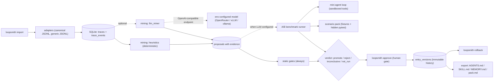

# LoopSmith MVP Architecture & Implementation Plan

A solo-hackathon MVP for LoopSmith: an evaluation-gated continual harness that imports coding-agent traces, proposes evidence-cited versioned memories/skills/instructions, gates them behind static checks and an optional model-backed A/B benchmark, requires approval, supports rollback, and exports Markdown harness packs.

# LoopSmith — Evaluation-Gated Continual Harness (Hackathon MVP)

LoopSmith is an offline, batch version of Prime Agent's `/refine` loop: it imports structured coding-session traces, proposes evidence-cited refinements to harness state (memories, skills, project instructions), gates every candidate behind a repeatable benchmark A/B plus static checks, requires human approval, versions everything with rollback, and exports approved refinements as Markdown that any coding agent (Claude Code, Codex, etc.) can consume.

**Design stance:** deterministic by default, LLM optional. The entire demo runs model-free; model-backed evaluation and LLM mining activate only when an OpenAI-compatible endpoint is configured via env vars. No dependency on Alan's internal model as an application API.

## 1. Concept mapping to Prime Agent's Continual Harness

| Prime Agent concept | LoopSmith MVP analog |
| --- | --- |
| Harness state H=(prompts, sub-agents, skills, memory) | Versioned `entries` of kinds: `instruction`, `skill`, `memory` (sub-agents out of scope) |
| `/refine` reads live trajectory, applies smallest CRUD edit | Batch mining of imported traces → smallest-edit `proposals` (create/update only; delete is P2) |
| Refinement records trigger + outcome (evidence-backed) | Every proposal carries `Evidence`: trace id + event refs + excerpt + pattern |
| Online refinement, no gates | **Evaluation gate** (static + optional A/B benchmark) + **human approval** before promotion |
| Rollback via refinement history | Immutable `entry_versions` + `rollback` command (pointer move, nothing deleted) |
| Reward-hacking risk (their Factorio anecdote) | Justification for the gate: checkers run outside the agent sandbox; ties go to baseline |

## 2. Architecture



Module map (each independently testable, behind small interfaces):

- `core` — Pydantic domain models, SQLite store (stdlib `sqlite3`, `PRAGMA user_version` migrations), versioning/promotion/rollback logic.
- `traces` — canonical event schema, importer adapters, event queries (retry loops, test outcomes, corrections).
- `mining` — deterministic heuristic miners; optional LLM miner using the same Proposal schema.
- `eval` — OpenAI-compatible client (env-driven), mini coding-agent loop, scenario pack loader, A/B runner, static gates + verdict rules.
- `export` — Markdown renderers.
- `cli` — thin Typer command modules; no business logic.

## 3. File tree

```
loopsmith/
├── pyproject.toml                # deps: typer, pydantic>=2, httpx; dev: pytest
├── README.md                     # pitch, quickstart, demo script, methodology disclosure
├── .env.example                  # LOOPSMITH_LLM_BASE_URL / API_KEY / MODEL
├── src/loopsmith/
│   ├── app.py                    # Typer root + sub-app wiring
│   ├── config.py                 # env-driven settings (pydantic models)
│   ├── paths.py
│   ├── core/
│   │   ├── models.py             # Entry, EntryVersion, Proposal, Evidence, EvalRun, ...
│   │   ├── store.py              # SQLite DDL v1 + CRUD + audit log
│   │   └── versioning.py         # promote / activate / rollback / stale guard
│   ├── traces/
│   │   ├── schema.py             # canonical Trace / TraceEvent models
│   │   ├── importers.py          # format registry: loopsmith-jsonl, generic-jsonl
│   │   └── query.py              # pattern queries used by miners
│   ├── mining/
│   │   ├── heuristics.py         # 4 deterministic miners (see §5)
│   │   ├── prompts.py            # prompt templates for LLM miner
│   │   └── llm_miner.py          # structured proposals from an OpenAI-compatible API
│   ├── eval/
│   │   ├── llm.py                # thin chat-completions client (httpx)
│   │   ├── agent.py              # bounded mini agent loop (sandboxed tools)
│   │   ├── scenarios.py          # manifest + fixture + checker loader, pack hashing
│   │   ├── runner.py             # baseline vs candidate driver, caching, transcripts
│   │   └── gates.py              # static checks + verdict rules
│   ├── export/
│   │   └── render.py             # AGENTS.md / skills/<slug>/SKILL.md / MEMORY.md / pack
│   └── cli/
│       ├── traces_cmd.py  mine_cmd.py  proposals_cmd.py
│       ├── eval_cmd.py    approve_cmd.py  export_cmd.py
├── benchmarks/default/           # scenario pack (4-6 mini repos)
│   ├── manifest.toml
│   └── scenarios/<id>/{workspace/, task.md, checker/test_hidden.py}
├── examples/traces/*.jsonl       # 2-3 crafted demo sessions (repo "acme-api")
├── demo.ps1                      # full pipeline run for the hackathon demo
└── tests/
    ├── conftest.py               # tmp DB + sample trace fixtures
    ├── test_store.py  test_versioning.py  test_importers.py
    ├── test_heuristics.py  test_gates.py  test_render.py
    └── test_e2e_demo.py           # full model-free pipeline test
```

## 4. Data schemas

### Canonical trace (Pydantic)

```python
class SessionMeta(BaseModel):
    agent: str | None      # "claude-code", "codex", ...
    model: str | None
    cwd: str | None
    started_at: datetime | None

class TraceEvent(BaseModel):
    seq: int
    ts: datetime | None
    kind: Literal["user.message", "assistant.message", "tool.call",
                  "tool.result", "file.edit", "test.run", "turn.outcome"]
    payload: dict           # typed per kind below
    raw: dict | None         # original event preserved for provenance

# tool.call payload: {name, args, ok, exit_code, duration_ms}
# test.run payload:  {framework, command, passed, failed}
# file.edit payload: {path, patch_present}
# turn.outcome payload: {status: success|failure|retry|user_correction, note}
```

### Domain models

```python
class Entry(BaseModel):        # registry row; UNIQUE(kind, name)
    kind: Literal["memory", "skill", "instruction"]
    name: str                  # slug

class EntryVersion(BaseModel): # immutable once written
    n: int                     # monotonic per entry
    body_md: str
    rationale: str | None
    status: Literal["candidate", "active", "superseded", "reverted"]

class Evidence(BaseModel):
    trace_id: str
    event_refs: list[int]      # seq numbers; must resolve in DB
    pattern: str               # e.g. "command_retry_loop"
    excerpt: str

class Proposal(BaseModel):
    op: Literal["create", "update"]
    kind: str; name: str
    target_n: int | None        # active version this edits (stale guard)
    body_md: str; rationale: str
    origin: Literal["heuristic", "llm"]
    status: Literal["pending", "evaluated", "approved", "rejected", "stale"]
    evidence: list[Evidence]
```

### SQLite DDL v1 (owned by `store.py`; nested objects as JSON columns)

```sql
traces(id, source, project, session_json, imported_at)
trace_events(id, trace_id→traces, seq, ts, kind, payload_json, raw_json, UNIQUE(trace_id, seq))
entries(id, kind, name, description, created_at, UNIQUE(kind, name))
entry_versions(id, entry_id→entries, n, body_md, rationale, status, created_at, UNIQUE(entry_id, n))
proposals(id, op, kind, name, target_n, body_md, rationale, origin, status, evidence_json, created_at)
eval_runs(id, proposal_id→proposals, benchmark_id, benchmark_hash, model, params_json,
          baseline_pack_hash, candidate_pack_hash, verdict, summary_json, started_at, finished_at)
eval_results(id, run_id→eval_runs, scenario_id, arm, run_ix, success, score,
             tokens_in, tokens_out, turns, wall_s, transcript_path)
audit_events(id, ts, kind, payload_json)   -- imported / approved / rejected / rolled_back / exported
```

## 5. Mining heuristics (deterministic, P0)

1. `command_retry_loop` — same command fails >=2 consecutive times then succeeds → memory ("command X is flaky; rerun once before debugging"). Evidence: the failing + succeeding events.
2. `user_correction` — user message with corrective content following an agent action, agent complies → instruction candidate grounded in the correction exchange.
3. `recurring_test_fix` — `test.run` failure → `file.edit` → later `test.run` pass → memory/skill of the fix-then-verify loop.
4. `build_tool_preference` — most frequent *successful* test/build command per project → instruction ("run tests via `make test` in this repo").

Frequency across multiple traces boosts proposal priority. The LLM miner (optional) generalizes beyond these templates using the same Proposal schema.

Demo traces are co-designed with the scenario pack (see §7) so the headline proposals have measurable behavioral effect.

## 6. CLI command design (Typer)

| Command | Purpose |
| --- | --- |
| `init` | create `.loopsmith/` + DB + defaults |
| `doctor` | DB, env, LLM endpoint reachability report |
| `import PATH [--format auto | loopsmith |
| `traces list / show ID` | inspect imported traces |
| `mine [--llm] [--max N]` | run miners → pending proposals |
| `proposals list / show ID / diff ID / reject ID` | review evidence-cited diffs |
| `eval PROPOSAL [--benchmark default] [--runs N]` | static gates; A/B if LLM configured |
| `benchmark list / smoke` | validate scenario checkers deterministically (no LLM) |
| `approve PROPOSAL [--yes] [--force]` | human gate; requires promote verdict or explicit `--force` (recorded as override) |
| `rollback KIND NAME [--to N]` | re-point active version; history retained |
| `history KIND NAME` | version timeline with producing proposal/eval |
| `export [--out dist/] [--format agents | skills |
| `status` | counts + last verdict |

## 7. Evaluation methodology

**Two-stage gate; conservative by design.**

Stage 1 — static gates (always, deterministic):

- body renders; size/slug limits; no duplicate of active content; all `Evidence.event_refs` resolve in DB; conflict check vs active entries (same name different kind, obvious duplication).

Stage 2 — behavioral A/B (only when LLM configured; otherwise verdict = `not_run` and approval requires `--force` with recorded override):

- Arms: **baseline** = current active pack rendered into the system prompt; **candidate** = baseline + proposal applied.
- Scenario pack: 4-6 tiny fixture repos, each with `task.md`, a workspace with a bug/failing visible test, and a hidden checker pytest run from a pristine copy *outside* the agent sandbox (anti-reward-hacking).
- Mini agent loop: tools `read_file / write_file / list_dir / run_tests / finish`, cwd locked to sandbox copy, command allowlist (`sys.executable -m pytest -q`), max 12 turns, temperature 0.
- N runs per arm per scenario (default 1; headline runs 3). Record success, tokens, turns, wall time, transcripts under `.loopsmith/runs//`.

**Verdict rules:**

- `reject`: static gate failure; OR candidate aggregate success  baseline AND zero per-scenario regressions.
- `inconclusive`: aggregate tie with no regressions → ties go to baseline (conservative gate).

**Reproducibility & cost:** record model id, params, `benchmark_hash` (manifest + fixture files hashed), pack hashes; cache arm runs by (benchmark_hash, pack_hash, model, params, scenario, run_ix) so shared baselines are never re-spent.

**Honesty note (goes in README):** demo scenarios are co-designed with the demo traces so the mined refinements matter (e.g., tests only pass via `make test`; baseline agent flails on raw pytest, candidate passes). Disclosed as demonstration methodology, not a general capability claim.

## 8. Promotion, versioning, rollback

- `approve`: single transaction → proposal approved; EntryVersion n+1 `active`; previous active → `superseded`; audit event. Stale guard: proposal `target_n` must match current active n, else refuse and mark stale.
- `rollback`: pointer move — selected version → `active`, later versions → `reverted`; nothing deleted; audit event. Rollback itself is a versioned event.
- Single-writer CLI assumption (solo tool); transactional updates + targeted tests cover the rest.

## 9. Export formats

- instructions → managed block in `AGENTS.md` (`` markers; round-trips without clobbering human content).
- memories → `dist/memory/MEMORY.md` (section per entry).
- skills → `dist/skills//SKILL.md` with frontmatter (name, description, when-to-use) matching common agent-skill conventions.
- `pack` → single `loopsmith-pack.md` for any agent's context. All exports stamped with entry version numbers for provenance.

## 10. LLM policy

OpenAI-compatible `/chat/completions` only, configured by env: `LOOPSMITH_LLM_BASE_URL`, `LOOPSMITH_LLM_API_KEY`, `LOOPSMITH_LLM_MODEL`. Works with OpenRouter, vLLM, LM Studio, ollama's compat layer. Thin httpx client (~60 lines), no SDK dependency. Never wired to Alan's internal model. No LLM → heuristic mining + static gates + `--force` path still complete.

## 11. Prioritized implementation plan (solo, ~24h to deadline)

**P0 — model-free core loop (14-16h) — the demo floor:**

1. Scaffold + config + store + domain models (2h)
2. Canonical trace schema + 2 importers + 2 crafted demo traces (3h)
3. Heuristic miners → evidence-cited proposals (3h)
4. Proposals CLI (list/show/diff) + static gates (2h)
5. Approve/promote + history + rollback + stale guard (2h)
6. Export renderers (2h)
7. E2E test + `demo.ps1` green (1.5h)

**P1 — model-backed headline (6-8h, only if an API key or local model is available):**
8. LLM client + `doctor` check (1h)
9. Scenario pack (4 scenarios) + mini agent loop + runner (4h)
10. A/B verdict integration + transcripts + caching (2h)
11. LLM miner (1.5h; optional even within P1)

**P2 — stretch (only if trivial):** `benchmark smoke` polish, richer tables, claude-code JSONL adapter, README GIF.

Schedule: tonight P0 steps 1-3; tomorrow morning steps 4-7; early afternoon P1; evening = buffer + demo rehearsal. If P1's agent loop overruns 2h beyond estimate, cut to 2 scenarios and N=1.

## 12. Test strategy

- Unit: store CRUD, versioning transitions (approve/rollback/stale), importer normalization, each heuristic's evidence grounding, verdict rules incl. tie→baseline, renderers.
- E2E: full model-free pipeline on synthetic traces (`import → mine → eval(static) → approve → export → rollback`).
- No network in tests; LLM client mocked. `benchmark smoke` validates checkers deterministically.

## 13. Riskiest assumptions (ranked)

1. **Real trace formats are volatile/undocumented** (Claude Code/Codex JSONL varies by version) → adapter breakage. Mitigation: canonical schema is the contract; demo uses crafted traces; generic-jsonl fallback; claude-code adapter is P2.
2. **Null-delta benchmark** — small models may ignore harness content, or both arms pass → wall of `inconclusive` verdicts, weak demo. Mitigation: co-designed scenarios where the refinement is *necessary*; ties stay baseline (honest gate); tokens/turns reported as secondary evidence.
3. **Nondeterminism at temperature 0** → flaky verdicts and wrong rejections. Mitigation: N=3 majority for headline runs; conservative ties; raw transcripts + hashes recorded; accept `inconclusive` as a legitimate verdict.
4. **API availability/cost on the night** → model path dead. Mitigation: demo runs fully model-free; `doctor` detects early; `--force` approval path exists.
5. **Version-state corruption** (double approve, stale proposals, rollback races). Mitigation: single-writer CLI, transactions, stale guard, targeted tests.
6. **Scope creep** — the top hackathon killer given ~24h. Mitigation: P0 hard cutline; module map is a contract; new ideas go to README future-work.
7. **Windows quirks** (this is the demo machine): subprocess pytest, paths, console encoding. Mitigation: `pathlib` everywhere, `sys.executable -m pytest`, explicit UTF-8, temp-dir sandboxes; verify on Windows first.
8. **Mini-agent reward hacking** (Prime Agent's own Factorio lesson): agent edits hidden tests or games the checker. Mitigation: checkers live outside the sandbox and grade a pristine copy; bounded tool allowlist; turn limits.

## 14. Out of scope (explicit)

Sub-agent specs, live session integration (LoopSmith is batch/offline), delete operations on entries, multi-user/concurrent writes, remote DBs, web UI, automatic promotion without human approval.
